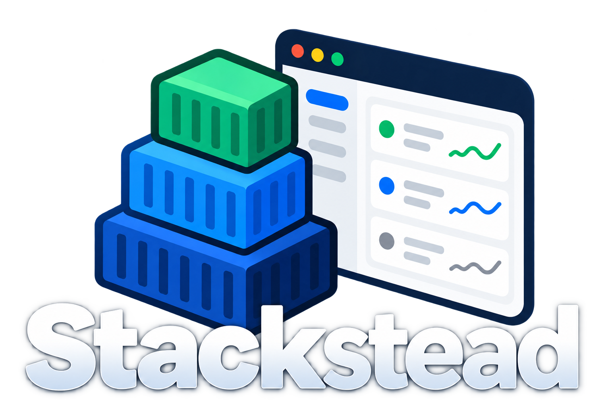

<div align="center">
  

  <h1>Your Docker host, finally in view.</h1>
  <p>Build, run, and troubleshoot Docker Compose stacks from one browser tab.</p>

  <p>
    
    
    
    
  </p>

  <p>
    <a href="#install"><strong>Get started</strong></a> ·
    <a href="#what-you-get">Explore features</a> ·
    <a href="docs/install.md">Installation guide</a> ·
    <a href="docs/cli.md">CLI reference</a>
  </p>
</div>

---

Stackstead is a small, self-hosted control panel for the Docker host in your
home lab or on your team's server. Create a service from an image or a
Dockerfile, change its ports, volumes and limits in a form, start and stop it,
follow its logs and watch its CPU, memory and network, all from one page.
It ships as a single binary, with no database server to run and nothing else
to install besides Docker.

**Your compose files stay the source of truth.** Stackstead edits them the way
you would: it keeps your comments, your key order and anything it does not
understand, and every stack keeps working with plain `docker compose`.

| 🧱 Build with confidence | 📡 See what's happening | 🗂️ Keep your files |
| --- | --- | --- |
| Configure images, Dockerfiles, ports, volumes, networks and limits with forms or YAML. | Follow live status, logs and resource history from one place. | Preview diffs, keep backups and continue using plain `docker compose`. |

## Why Stackstead

Running a handful of containers on one machine usually starts simple and
gets messy:

- **"Which port was that again?"** You open five compose files and
  `docker ps` to find out what is running where.
- **YAML papercuts.** A wrong indent or a mistyped port mapping is only
  discovered when `docker compose up` fails.
- **"What happened at 3am?"** By the time you look, the container has
  restarted and the evidence is gone.
- **Heavy tools for a light job.** Full container platforms want their own
  database, agents or containers, and often rewrite or take over your files.

Stackstead is built for exactly this situation: one Docker host, a few to a
few dozen containers, and someone who wants a clear view and safe edits
without a platform to maintain.

## What you get

- **A live overview.** Every stack and service on the machine, its status,
  health and running containers, updated the moment Docker reports a change.
- **A dashboard at a glance.** Host tiles for CPU, memory, disk and network,
  a sparkline per stack, alerts for what needs attention and a live feed of
  Docker events.
- **Forms instead of YAML.** Image or Dockerfile, ports, volumes, environment
  variables, networks and static IPs, CPU and memory limits, restart policy
  and healthcheck. Port and IP clashes are checked before anything is
  written.
- **See before you save.** Every change, from the form or the built-in YAML
  editor, is shown as a diff before it touches the file, and the previous
  version is kept as a `.bak`. If someone edits the file at the same time,
  Stackstead notices and lets you merge instead of overwriting.
- **Dockerfile first.** Build images from local Dockerfiles, not only pull
  from a registry. Pick folders and files with a built-in file browser.
- **Bring your existing stacks.** Import a compose file you already have,
  where it already lives. Nothing is moved, and nothing changes until you
  edit it.
- **One-click lifecycle.** Up, down, restart, pull and build, with the
  command output streamed live and kept for later.
- **Live logs.** Follow all of a stack's containers at once, filter by
  service or by stdout and stderr, search, and pause. After a dropped
  connection the stream picks up where it left off.
- **Resource history.** CPU, memory, network and disk I/O for every service,
  live and for the last 72 hours (configurable), so you can see what
  happened while you were away.
- **Plays well with Grafana.** An optional Prometheus `/metrics` endpoint,
  protected by its own token.
- **No lock-in.** Stop using Stackstead tomorrow and your stacks are just
  compose files in folders. Stopping Stackstead never stops your containers,
  and removing a stack never deletes its files.

## Who it is for

- **Home-lab owners** running media servers, home automation, monitoring and
  side projects on a NAS, mini PC or Raspberry Pi (amd64 and arm64).
- **Small teams** with a shared Docker host for internal tools, staging or
  CI services, who want a friendlier way in than SSH and `vim`.
- **Developers** who want to try a Dockerfile as a properly configured
  service without writing compose YAML by hand.

It deliberately does not try to be Kubernetes, a multi-host orchestrator or
a CI system. One host, done well.

## How it compares

Tools such as Portainer, Dockge and Komodo cover parts of the same ground,
and each is a good choice for some setups. Stackstead's angle is the
combination: form-driven editing that preserves hand-written compose files,
Dockerfile-first builds, built-in logs and metrics history, and a single
small binary that runs natively on the host, with no containers or external
database of its own.

## Install

One command on a Linux server (systemd) or a Mac:

```bash
curl -fsSL https://github.com/rcss-labs/stackstead/releases/latest/download/install.sh | sudo sh
```

The script downloads the latest release, verifies it against the release's `SHA256SUMS`
(it always does, and refuses on a mismatch), installs a supervised service and prints
the URL to finish setup. Pin a version with `... | sudo sh -s -- --version vX.Y.Z`.
Running it again upgrades in place and never touches your config, data or stacks.
Releases are not signed yet; the checksum guards against corrupt downloads, and you can
compare `SHA256SUMS` by hand.

- **Debian, Ubuntu, Fedora, Rocky and friends:** download the `.deb` or `.rpm` from the
  [releases page](https://github.com/rcss-labs/stackstead/releases) and run
  `sudo apt install ./stackstead_<version>_amd64.deb` or
  `sudo dnf install ./stackstead-<version>-1.x86_64.rpm`. The binary lands in
  `/usr/bin/stackstead` and the service starts right away.
- **macOS (Intel and Apple silicon):** the script above, or the universal `.pkg`. The
  package is not signed with an Apple Developer ID yet, so Gatekeeper blocks a
  double-click: right-click it and choose **Open**, or run
  `sudo installer -pkg stackstead_<version>_darwin.pkg -target /`. Stackstead runs as a
  LaunchAgent while you are logged in.
- **From source, by hand:** build with `make build` and follow the
  [manual systemd steps](docs/install.md#manual-install-systemd).

Stackstead listens on `127.0.0.1:8420`. Open it on the host and create your admin account;
from another machine you also need the one-time setup token from
`journalctl -u stackstead | grep setup_token` (on macOS from
`~/Library/Logs/Stackstead/stackstead.log`). The service user is in the `docker` group, which
is root-equivalent on the host, so keep it on localhost or behind a TLS proxy.
Paths, private registries, unit drop-ins, uninstall and purge are in
[docs/install.md](docs/install.md).

## Build from source

Prefer to hack on it, or try it without installing a service? You need Docker Engine
and the Docker Compose v2 plugin (`docker compose`).

```bash
make build                 # needs Go and Node >= 22; produces bin/stackstead (the UI build enforces the bundle and font budgets)
./bin/stackstead serve     # listens on http://127.0.0.1:8420
```

Open http://127.0.0.1:8420 on the same machine and create your admin
account. Then create a stack from an image, or import a compose file you
already have.

Settings live in a small YAML file or in `STACKSTEAD_*` environment
variables; see [`deploy/config.example.yaml`](deploy/config.example.yaml)
for every option (listen address, stacks folder, data folder, metrics
retention and more).

## Command line

The same binary is a command-line client for a running server, and a set of
host-side admin commands:

```bash
stackstead login https://stacks.example.com   # saves a session as a context
stackstead stacks ls
stackstead stacks up web                      # follows the operation live
stackstead logs web -f --tail 100
stackstead metrics web --from 2h
stackstead stacks ls -o json                  # scriptable output
sudo -u stackstead stackstead db backup /backups/stackstead.db
sudo -u stackstead stackstead admin set-password   # forgot the admin password
sudo -u stackstead stackstead health         # config, database, server, Docker
```

Exit codes are stable (`0` ok, `3` not logged in, `4` not found, `9` operation
failed, and so on). The session lives in `~/.config/stackstead/contexts.json`,
a file that deserves the same care as an SSH key. Online admin commands
(`set-password`, `revoke-sessions`, `metrics-token`, `db backup`, `db check`) do
not take the server lock, so do not run them while a `db restore` is in
progress. Full reference: [docs/cli.md](docs/cli.md).

## Good to know

- **Security.** Controlling Docker is equivalent to root on that machine, so
  Stackstead listens on localhost only by default and has a single admin
  account. For remote access, put it behind a TLS reverse proxy. Details in
  [docs/security.md](docs/security.md).
- **Logs are not copied.** Logs are read from Docker when you look at them,
  so they go back as far as Docker's own log settings allow.
- **Compose override files** (`compose.override.yaml`) are not supported yet.
  Stackstead tells you when it finds one.
- **If Docker is down**, Stackstead keeps running, shows a banner, and
  reconnects when Docker is back.
- **Accessible.** The UI works with a keyboard and screen readers, follows
  your light or dark theme (with a theme toggle) and reduced-motion setting,
  offers a compact or comfortable density, and fits a phone screen.
- **Third-party.** The UI ships IBM Plex Sans and Geist Mono, both under the
  SIL OFL-1.1, served at `/licenses/IBMPlexSans-OFL.txt` and
  `/licenses/GeistMono-OFL.txt`.

## Documentation

- [API and observability reference](docs/api.md): every endpoint, log
  streaming and resume, metrics history, Prometheus setup.
- [Installing](docs/install.md): the script, packages, the macOS installer,
  paths, upgrades, uninstall and purge, exit codes.
- [Command line](docs/cli.md): every command, exit codes, host administration,
  backup and restore.
- [Security](docs/security.md): threat model, reverse proxies, first-run
  setup, password changes.
- [Building and development](docs/development.md): make targets, dev loop,
  tests.

## Status

Stackstead is young and under active development. The web UI, stack
management, logs, metrics, a command-line client and installers for Linux and
macOS are in place.

## Licence

AGPL-3.0-only; see [LICENSE](LICENSE). The AGPL asks that anyone who interacts
with Stackstead over a network can get its source: the public repository
satisfies that for unmodified published versions (`stackstead version` and
`/api/status` show the exact version and commit). If you run a modified copy for
other people, publish your changes.
